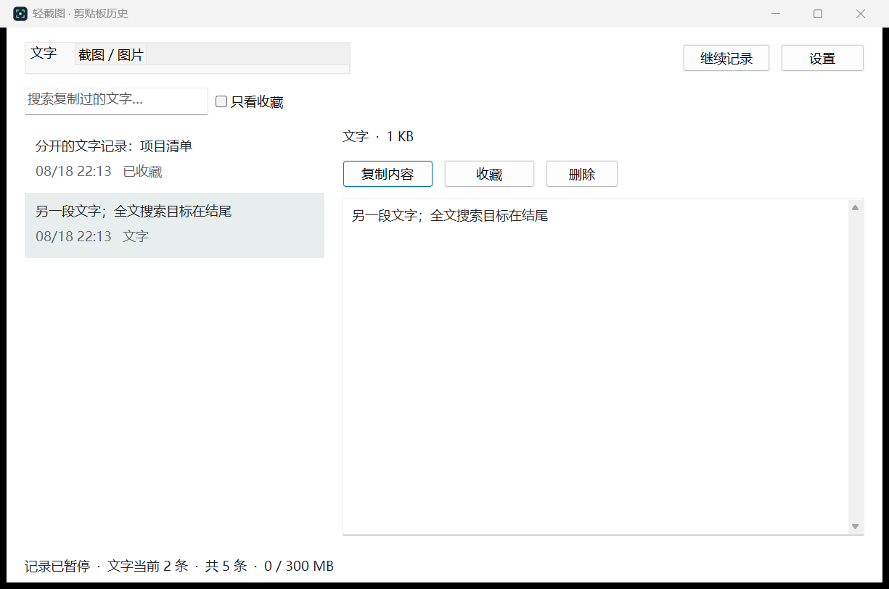
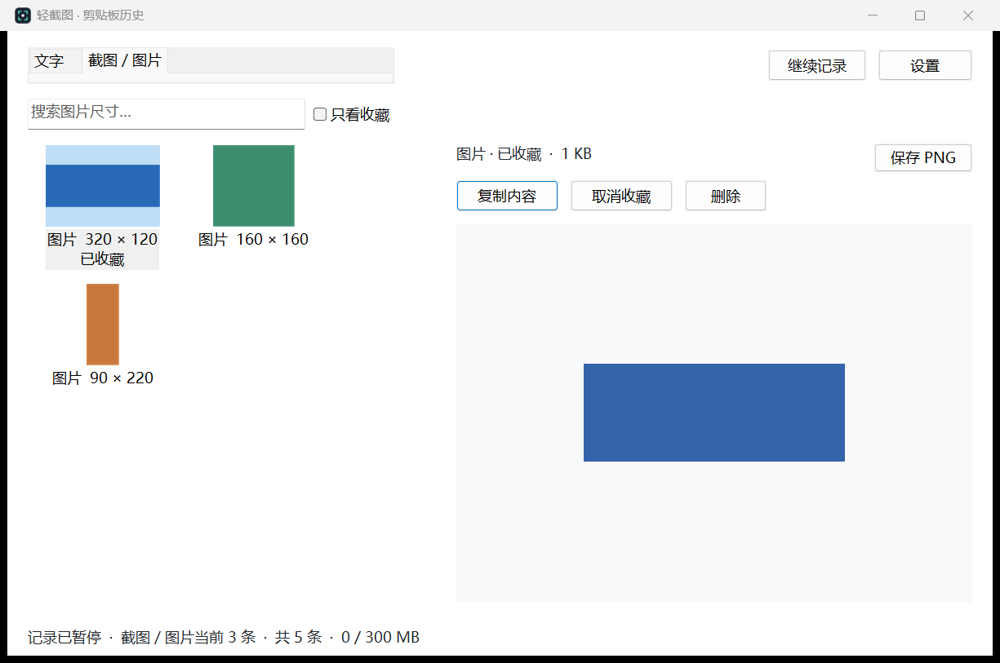

# 轻截图 · LightCapture

一个原生 Windows 小工具：**Alt+A 截图，Ctrl+Alt+V 找回复制过的文字和图片**。

当前版本：**1.2.0**。项目用于持续维护自己的日常工具。

## 功能

- 框选截图，回车或双击复制，Ctrl+S 保存 PNG，Esc 取消。
- “文字”和“截图／图片”两个历史页签，支持全文搜索或图片尺寸搜索。
- 图片缩略图网格、大图预览、重新复制和 PNG 导出。
- 两页分别筛选收藏，记住上次页签；记录和设置退出重开后保留。
- 最多 500 条、约 300 MB 内容容量；自动清理最旧的未收藏记录。
- 可暂停记录、排除应用、选择打开历史的快捷键。
- 当前用户登录后启动；托盘尚未就绪时重试，平时通过系统消息等待操作。

截图使用生成的演示文字和色块，不含个人剪贴板内容：




## 构建

需要 Windows 10/11 x64、Visual Studio 2022 或 Build Tools，并安装“使用 C++ 的桌面开发”和 Windows SDK。程序运行时不需要 Python、浏览器或额外的 .NET 安装。

在 PowerShell 中：

```powershell
git clone https://github.com/YuchuAn222/lightcapture.git
cd lightcapture
.\scripts\build.cmd
.\scripts\test.ps1
.\build\LightCapture.exe --clipboard
```

脚本通过 `vswhere` 找到 C++ 编译工具，也可以在 x64 Native Tools Command Prompt 中运行。构建结果保存在 `build/`。

提交后，GitHub Actions 会执行同一套构建和原生测试；成功的运行会提供 Windows x64 可执行文件作为构建产物。UI 操作仍需要真实桌面验证。

## 使用

| 操作 | 方法 |
| --- | --- |
| 框选截图 | Alt+A |
| 复制截图 | 回车、双击选区，或点击“复制” |
| 保存截图 | Ctrl+S |
| 取消截图 | Esc 或鼠标右键 |
| 打开剪贴板历史 | 默认 Ctrl+Alt+V，或托盘菜单 |
| 重新复制历史 | 双击条目；随后 Ctrl+V 粘贴 |
| 开关自启、退出 | 右键托盘图标 |

自启也可通过命令行设置：

```powershell
.\build\LightCapture.exe --enable-autostart
.\build\LightCapture.exe --disable-autostart --quit
```

自启指向当前 EXE 的位置，移动程序后需要重新开启。退出工具会结束本次运行，已配置的下次登录启动仍然保留。

## 数据与边界

历史数据库位于 `%LOCALAPPDATA%\LightCapture\Clipboard\history.db`，只保存在本机，不会随 Git 提交。数据库没有额外加密；可以暂停记录、排除应用和清空历史。工具尊重应用提供的禁止历史记录标记，但不是所有应用都会提供此标记。

支持纯文字和图片，不备份原文件、不保留富文本排版，也不追溯工具启动前的复制记录。单条文字上限约 2 MB，图片上限 1600 万像素或编码 32 MB。数据库及写入过程另有少量磁盘开销。收藏占满容量时，新内容会提示未保存。

Alt+A 冲突时默认优先响应，可在托盘关闭。历史快捷键冲突时可在设置中更换。锁屏、安全桌面和部分管理员窗口受 Windows 权限限制。

## 后续维护

- [结构、验证和发版方法](docs/MAINTENANCE.md)
- [版本记录](CHANGELOG.md)
- 遇到问题请开 Issue，写清版本和复现步骤；不要上传剪贴板数据库。

仓库只提交源码、测试、文档和生成的演示图。运行日志、个人路径快捷方式、历史记录、凭据以及编译临时文件均不属于源码。
